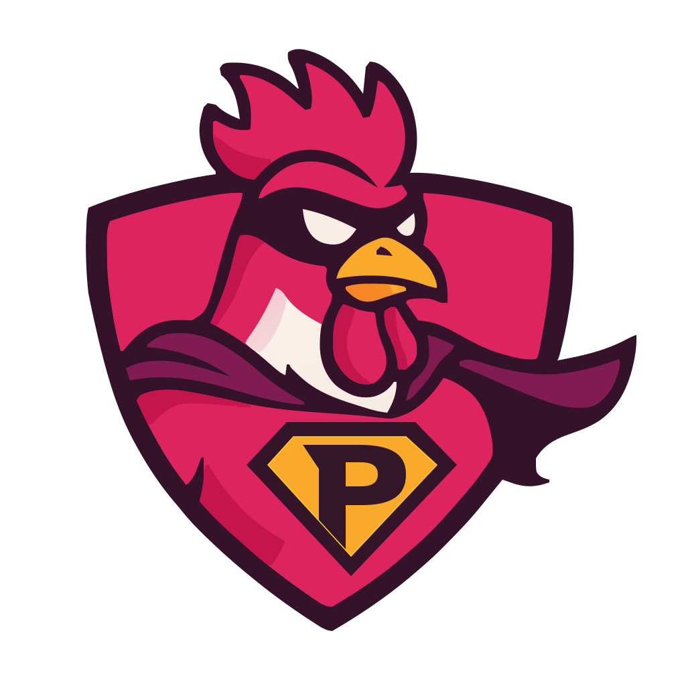

<div align="center">



# PinkRooster.ProviderConfig

**Configure AI providers in .NET and resolve clients by provider ID and model.**

[](https://github.com/pinkroosterai/PinkRooster.ProviderConfig/actions/workflows/ci.yml)
[](https://www.nuget.org/packages/PinkRooster.ProviderConfig)
[](LICENSE)
[](https://dotnet.microsoft.com/download/dotnet/10.0)

[Quickstart](#quickstart) · [Embeddings](#generate-embeddings) · [Packages](#packages) · [Configuration](#configuration) · [Registration](#registration) · [Build and test](#build-and-test)

</div>

Declare credentials, endpoints, and model defaults in .NET configuration instead of building SDK clients throughout your app. Inject `IChatClient` or `IEmbeddingGenerator<string, Embedding<float>>` from `Microsoft.Extensions.AI`, or use a factory when the provider and model are chosen at runtime. Jev System One uses Jev.Net’s `ITypeSafeClient`.

The library targets **.NET 10** and is published as a [NuGet prerelease](https://www.nuget.org/packages/PinkRooster.ProviderConfig). The core depends on no provider SDK; install only the adapters you use.

## Quickstart

### 1. Install

Create a console app with the [.NET 10 SDK](https://dotnet.microsoft.com/download/dotnet/10.0), or add the OpenAI adapter to an existing .NET 10 host. The adapter installs the core transitively.

```sh
dotnet new console --framework net10.0 --output ProviderQuickstart
cd ProviderQuickstart
dotnet package add Microsoft.Extensions.Hosting
dotnet package add PinkRooster.ProviderConfig.OpenAI --prerelease
```

### 2. Configure a provider

Create `appsettings.json` in the project directory. `chat` is an ID you choose; `openai_responses` is the adapter type that selects the OpenAI Responses API.

```json
{
  "Providers": {
    "chat": {
      "Type": "openai_responses"
    }
  }
}
```

Set `Providers__chat__ApiKey` to your OpenAI API key in the environment of the process running the app. The .NET host maps double underscores to `:`, so this supplies `Providers:chat:ApiKey` without putting the key in source control. `OPENAI_API_KEY` is not used as a fallback.

### 3. Send a message

Replace `Program.cs`, then run `dotnet run` from the project directory. Use a Responses API model available to your OpenAI account if `gpt-5-mini` isn’t available.

<!-- quickstart:start -->
```csharp
using Microsoft.Extensions.AI;
using Microsoft.Extensions.DependencyInjection;
using Microsoft.Extensions.Hosting;
using PinkRooster.ProviderConfig;
using PinkRooster.ProviderConfig.OpenAI;

HostApplicationBuilder builder = Host.CreateApplicationBuilder(args);
builder.Services.AddProviderConfig()
    .AddOpenAI()
    .AddChatClient("chat", "gpt-5-mini");

using IHost host = builder.Build();
await host.StartAsync();

IChatClient chat = host.Services.GetRequiredService<IChatClient>();
ChatResponse response = await chat.GetResponseAsync("Say hello in one sentence.");
Console.WriteLine(response.Text);

await host.StopAsync();
```
<!-- quickstart:end -->

## Generate embeddings

Using the same OpenAI adapter, add this entry alongside `chat` inside `Providers` (or replace `chat` if you only need embeddings). Set `Providers__search__ApiKey` in the environment; each provider ID has its own settings.

```json
"search": {
  "Type": "openai_embedding",
  "Models": {
    "text-embedding-3-small": { "Dimensions": 512 }
  }
}
```

After `.AddOpenAI()`, chain `.AddEmbeddingGenerator("search", "text-embedding-3-small")`. You can remove `.AddChatClient(...)` and the chat request if you are using only the embedding provider. After `host.StartAsync()`, resolve the generator and call it:

```csharp
IEmbeddingGenerator<string, Embedding<float>> generator =
    host.Services.GetRequiredService<IEmbeddingGenerator<string, Embedding<float>>>();
GeneratedEmbeddings<Embedding<float>> result = await generator.GenerateAsync(["A sample document"]);
Console.WriteLine(result[0].Vector.Length);
```

`Dimensions` is optional. When configured, it must be positive and is passed to the embedding SDK for that model. Choose a dimension supported by the upstream model, and keep it consistent with your vector index.

## Packages

| Package | Registration | Configured `Type` → client |
|---|---|---|
| [PinkRooster.ProviderConfig](docs/PinkRooster.ProviderConfig.md) | `AddProviderConfig()` | Core registry, client factories, validation, and test support; no built-in types |
| [PinkRooster.ProviderConfig.OpenAI](docs/PinkRooster.ProviderConfig.OpenAI.md) | `AddOpenAI()` | `openai` → Chat Completions; `openai_responses` → Responses (both `IChatClient`); `openai_embedding` or `openai_embeddings` → `IEmbeddingGenerator<string, Embedding<float>>` |
| [PinkRooster.ProviderConfig.Anthropic](docs/PinkRooster.ProviderConfig.Anthropic.md) | `AddAnthropic()` | `anthropic` → Anthropic Messages (`IChatClient`) |
| [PinkRooster.ProviderConfig.Jev](docs/PinkRooster.ProviderConfig.Jev.md) | `AddJev()` | `jev` → Jev System One (`ITypeSafeClient`) |

## Configuration

`AddProviderConfig()` binds the top-level `Providers` section from the container’s `IConfiguration`. No separate binding is needed. The builder’s `Configure(...)` callback runs after binding and can add or replace entries in code. Provider configuration is not hot-reloaded.

| Setting | Behavior |
|---|---|
| `Type` | Required. Register the matching adapter before building the host. Provider IDs and type names are case-insensitive. Provider IDs allow ASCII letters, digits, `_`, and `-`. |
| `ApiKey` | Required for Anthropic and Jev. OpenAI types require it unless you configure a custom `Endpoint`; with no key they send the placeholder `providerconfig-no-key`. |
| `Endpoint` | Optional absolute HTTP or HTTPS URL. For an OpenAI-compatible local server that implements Chat Completions, use `Type: "openai"` and an endpoint such as `http://localhost:11434/v1`. Choose a type whose API the server actually implements. |
| `Timeout` | Optional positive duration, such as `"00:02:00"`. For OpenAI chat, it bounds the wait for headers and gaps between streamed chunks, not the entire stream. Anthropic uses an SDK request timeout and defaults to 30 seconds for a non-streaming request. |
| `Store` | Only `openai_responses` uses this setting among the built-in types. Defaults to `false`; set `true` to opt in to storing responses. |
| `Models` | Optional settings keyed by model ID. Configured model IDs are case-insensitive and allow ASCII letters, digits, `_`, `-`, and `.`. This section is not an allowlist. |

Use HTTPS for remote providers. A key sent to a non-loopback HTTP endpoint travels in cleartext; the library logs a warning on first validation if logging is configured. The built-in adapters do not fall back to SDK environment variables (`OPENAI_*`, `ANTHROPIC_*`, or `TYPESAFE_API_KEY`, `TYPESAFE_BASE_URL`, and `TYPESAFE_DEFAULT_MODEL`). Use normal .NET configuration sources to supply settings explicitly.

### Per-model chat defaults

Set defaults under `Providers:<id>:Models:<modelId>`, for example `Providers:chat:Models:gpt-5-mini:MaxOutputTokens`. Clients from `AddChatClient` or `IChatClientFactory` use these defaults for both regular and streaming calls. `ChatOptions.ModelId`, when supplied, selects the model whose defaults apply; otherwise the registered or requested model is used. Unlisted models get no defaults.

Explicit caller options win, including zero temperature and an empty `StopSequences` list. `AdditionalProperties` merge by key with caller values taking precedence, and the caller’s options are not mutated. See the [supported settings and ranges](docs/PinkRooster.ProviderConfig.md#model-defaults-configuration). Passing validation does not mean the upstream model supports every setting.

### Validation and troubleshooting

A .NET host validates configured providers when it starts. Without a host, validation occurs when options are first accessed. Validation checks registered types, required keys, endpoint URLs, and setting ranges; it does not contact the upstream API. At request time, `openai_responses` throws if the upstream reports a failure in an otherwise successful HTTP response.

| Symptom | Check |
|---|---|
| `Type` is not known | Install the adapter and call its registration method, such as `.AddOpenAI()`. |
| `ApiKey` is required | Set `Providers__<id>__ApiKey` for the provider ID in your configuration, not the adapter type or model name. |
| Provider missing or wrong client kind on resolution | Match the ID passed to the registration or factory with the `Providers` entry. Use an embedding type for an embedding generator and a chat type for a chat client. |
| Upstream rejects the request | Check credentials, model access, supported settings, and whether the endpoint implements the chosen API. |

## Registration

Use `AddChatClient`, `AddEmbeddingGenerator`, or `AddSystemOneClient` for a fixed provider and model. Each call registers a lazy singleton. Pass `serviceKey` to register multiple clients of the same interface without relying on the last unkeyed registration. For example, for the `chat` provider above:

```csharp
builder.Services.AddProviderConfig()
    .AddOpenAI()
    .AddChatClient("chat", "gpt-5-mini", serviceKey: "assistant");
```

Resolve it with `GetRequiredKeyedService<IChatClient>("assistant")` or inject it with `[FromKeyedServices("assistant")]`. Provider IDs passed to client registrations are checked when those services are first resolved, not at host startup.

| If the provider or model is selected at runtime, inject… | Then call… |
|---|---|
| `IChatClientFactory` | `GetChatClient(providerId, modelId)` |
| `IEmbeddingGeneratorFactory` | `GetEmbeddingGenerator(providerId, modelId)` |
| `ISystemOneClientFactory` (Jev adapter) | `GetSystemOneClient(providerId, modelId)` |

The factory initializes the registered provider once on first use, then invokes its model-to-client function on each factory call. If Jev’s `SystemOneOptions.Model` is omitted, the client uses the model ID passed when it was created; an explicit caller model takes precedence.

### Custom provider types

Use `AddProviderType<TClient>(type, create, options)` to register your own adapter. The creator runs once per provider and returns a `Func<string, TClient>` that accepts a model ID. Supply a `ProviderTypeOptions` for custom validation and use `context.RegisterDisposable(...)` to tie shared resources to the container lifetime. For client types other than the built-in interfaces, resolve them through `IProviderClientFactory.GetClient<TClient>(providerId, modelId)`.

Repeating `AddProviderConfig()` or a built-in adapter registration is safe. A repeated custom type registration is a no-op only if the client kind and creator match; use a static method group if multiple callers may register the same type.

## Build and test

From the repository root with the SDK specified in [global.json](global.json):

```sh
dotnet build PinkRooster.ProviderConfig.slnx -c Release
dotnet test --solution PinkRooster.ProviderConfig.slnx -c Release --no-build
dotnet pack PinkRooster.ProviderConfig.slnx -c Release --no-build -o artifacts
```

For tests of your own integrations, register `new ProviderHttpHandler(handler)` as a singleton to make the built-in adapters use your test handler instead of the network. Do not register it in production.

Repository live tests are opt-in and call real APIs:

| Tests | Environment variables |
|---|---|
| OpenAI chat | `PROVIDERCONFIG_LIVE_OPENAI_KEY`, `PROVIDERCONFIG_LIVE_OPENAI_MODEL` |
| OpenAI embeddings | `PROVIDERCONFIG_LIVE_OPENAI_KEY`, `PROVIDERCONFIG_LIVE_OPENAI_EMBEDDING_MODEL` (falls back to `PROVIDERCONFIG_LIVE_OPENAI_MODEL`) |
| Anthropic | `PROVIDERCONFIG_LIVE_ANTHROPIC_KEY`, `PROVIDERCONFIG_LIVE_ANTHROPIC_MODEL` |
| Jev | `TYPESAFE_LIVE_TESTS=1`, `TYPESAFE_API_KEY` |

## Project links

[Changelog](CHANGELOG.md) · [Contributing](CONTRIBUTING.md) · [Security reporting](SECURITY.md) · [MIT license](LICENSE)
